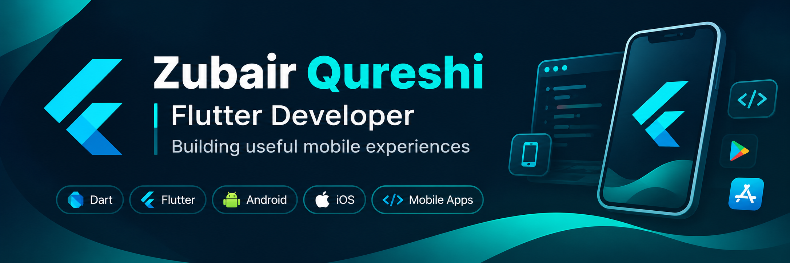

 

  

# Hi, I'm Zubair Qureshi 👋

### Flutter Developer | Dart | Mobile Application Development

I’m a Flutter Developer with approximately 4 years of hands-on experience building cross-platform mobile applications.

My professional experience includes developing courier management applications for delivery personnel and customers, working on UI development, REST API integration, debugging, and production releases.

I enjoy building practical mobile products, improving application architecture, and exploring how AI can enhance mobile development.

---

## 🛠️ Tech Stack

**Languages & Frameworks**

  

**State Management & Backend**

  
  
  

**Development Tools**

  

**Database & Storage**

  
  

---

## 🚀 Personal Projects

### Text Toolkit
A Flutter-based text utility application featuring text tools, prompt building, text analysis, stylish text, and note-taking.

- Published on Google Play.
- Developed with Flutter and Dart.
- Includes in-app purchases and AdMob integration.

[View on Google Play](https://play.google.com/store/apps/details?id=com.zedroidlabs.texttoolkit)

### Save Karlo
A local-first bookmark manager built with Flutter.

- Save links directly through the Android share menu.
- Search, organize, pin, and manage saved links.
- JSON backup and restore functionality.
- Currently in closed testing.

---

## 💻 Public Flutter Samples

| Repository | What to explore |
|---|---|
| [Currency Converter](https://github.com/zuberjavedqureshi/currency_converter) | GetX state management, REST API integration, JSON mapping, searchable selectors and currency conversion |

These are public learning samples. My primary application source repositories are maintained separately.

---

## 📊 GitHub Activity

  
  

  <a href="https://github.com/zuberjavedqureshi?tab=repositories">
    Explore my repositories →
  </a>

---

## 🤝 Connect With Me

  

  💬 Open to Flutter Developer opportunities, collaborations, and interesting projects.

